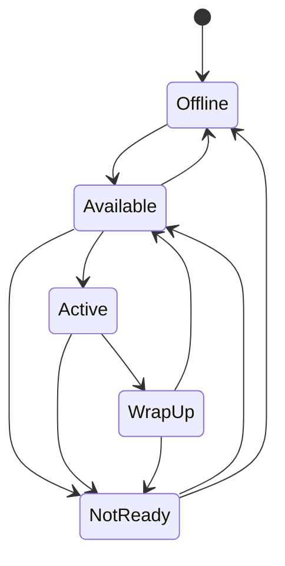

# Agent Wallboard API — Status State Machine

**A REST API for tracking call-center agents in real time. Agent status follows an explicit state machine (Available → Active → Wrap Up → …), so invalid moves are rejected, and every change is saved atomically to disk.**


[](https://github.com/tawan230666/agent-wallboard-learn/actions/workflows/ci.yml)

> **ENGSE203, Lab 5 (Node.js backend), Phase 1** of the Agent Wallboard case study. Phase 2 adds MongoDB and WebSockets: [engse203-lab6-database-integration](https://github.com/tawan230666/engse203-lab6-database-integration).

## Status state machine



A request for a transition that isn't allowed returns `400` and lists the valid next states, for example:

```json
{ "success": false, "error": "Disallowed transition: Available → Wrap Up",
  "allowedTransitions": ["Active", "Not Ready", "Offline"] }
```

## Highlights

- **Joi validation** on request bodies, and `409 Conflict` for duplicate agent codes
- **Atomic persistence:** writes go to a temp file and are then renamed over `agents.json`, so a crash never leaves a half-written file
- **Dashboard stats:** counts and percentages per status for wallboard display
- **Tested:** 7 API tests (Node's built-in test runner + Supertest) run in CI against a throwaway copy of the data

## Run

```bash
git clone https://github.com/tawan230666/agent-wallboard-learn.git
cd agent-wallboard-learn
npm install
npm run dev        # http://localhost:3001
npm test
```

## API

| Method | Endpoint | Description |
|---|---|---|
| `GET` | `/api/agents` · `/api/agents/:code` · `/api/agents/count` | Read agents |
| `POST` | `/api/agents` | Create an agent (`code`, `name`) |
| `PATCH` | `/api/agents/:code/status` | Change status (validated against the state machine) |
| `POST` | `/api/agents/:code/login` · `/logout` | Start or end a shift |
| `GET` | `/api/dashboard/stats` | Status breakdown with percentages |
| `GET` | `/health` · `/api/storage/health` | Service and storage health |

---

**Author:** Tawan Tiphkun (ธาวัน ทิพคุณ), 67543210033-6, [@tawan230666](https://github.com/tawan230666), Software Engineering, RMUTL Chiang Mai
